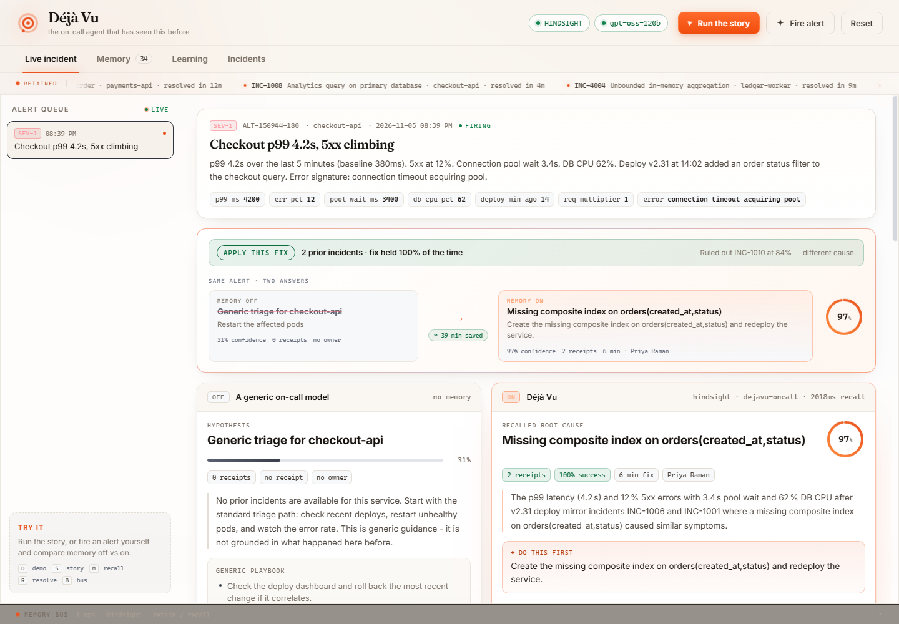
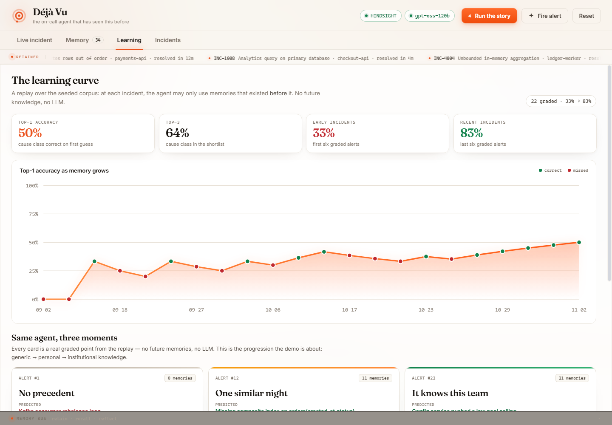
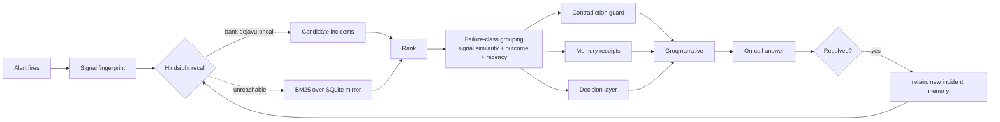

<p align="center">
  <a href="https://dejavu-tau.vercel.app">
    
  </a>
</p>

<h1 align="center">Déjà Vu</h1>
<p align="center"><strong>The on-call agent that has seen this before.</strong></p>

<p align="center">
  <a href="https://dejavu-tau.vercel.app"></a>
  
  
  
  
</p>

When an alert fires at 3 a.m., the answer is almost never in the model's weights. It is in your own incident history: the same failure, on the same service, six weeks ago, fixed in six minutes by Priya — and the *other* incident that looked identical but had a different cause.

Déjà Vu is an on-call SRE agent with long-term incident memory. It recalls the incident, the signals that preceded it, the fix that actually worked, who shipped it, how long it took, and whether it held. Every claim comes back with a **receipt**.

<p align="center">
  <strong><a href="https://dejavu-tau.vercel.app">Live demo</a></strong>
  &nbsp;·&nbsp; <a href="https://dejavu-tau.vercel.app/?tour=1">Guided tour</a> (runs the story automatically)
  &nbsp;·&nbsp; <a href="docs/ARCHITECTURE.md">Architecture</a>
</p>

---

## The same alert, answered twice

| | Memory **OFF** | Memory **ON** |
|---|---|---|
| Decision | nothing to act on | **APPLY THIS FIX** |
| Hypothesis | "Generic triage for checkout-api" | **Missing composite index on `orders(created_at,status)`** |
| First action | "Restart the affected pods" | `CREATE INDEX CONCURRENTLY` + verify the query plan |
| Evidence | none | `INC-1006`, `INC-1001` |
| Confidence | 31% | **97%** |
| Owner | — | Priya Raman |
| Fix time | — | 6 minutes |
| Outcome | — | resolved, 2/2 times |
| Ruled out | — | `INC-1010` — similar alert, different cause |
| Auditability | nothing to check | every claim links to an incident |

Same model, same alert, same prompt. The only difference is memory.

Then you resolve it. The lesson is retained with your name and the minutes it took. Fire the same fingerprint again and the agent answers from memory — in milliseconds.

**Try it:** `D` fire a demo alert · `S` run the whole story · `M` recall with memory · `R` resolve and retain · `B` memory bus · `1`–`4` switch screens

---

## Why this is not "a chatbot over incidents"

| Most memory demos | Déjà Vu |
|---|---|
| Recall similar text | **Memory receipts** — incident ID, engineer, fix time, outcome on every row |
| Treat every memory equally | **Outcome-weighted recall** — a fix that failed is demoted; a fix that worked 3/3 ranks first |
| Pretend near-duplicates are the same | **Contradiction guard** — surfaces the look-alike incident with a *different* cause and the one signal that separates them |
| Hide behind a score | **Signal fingerprint** — shows the alert's signals next to the recalled incident's, signal by signal |
| Memory grows forever | **Decay** — stale memories are flagged "revalidate before acting" |
| Read-only memory | **Closed loop** — resolve → retain → the next identical alert is answered instantly |
| Hand you a paragraph | **A decision** — `APPLY THIS FIX` / `VERIFY FIRST` / `DO NOT APPLY`, with the reason and the check to run first |
| Claims it improves | **Measured replay** — a learning curve computed from the corpus, with no future knowledge and no LLM |

---

## Measured, not claimed

A replay walks the 34-incident corpus in chronological order. At each incident the agent may only use memories that existed **before** it. No peeking, no LLM.

<p align="center">
  
</p>

| Metric | Result |
|---|---|
| Incidents in the corpus | 34 across 4 services, 17 failure classes |
| Incidents graded by the replay | 22 |
| Top-1 accuracy (cause class) | **50%** |
| Top-3 accuracy | **64%** |
| First six graded alerts | **33%** |
| Last six graded alerts | **83%** |
| Recall latency | ~2 s against Hindsight Cloud · single-digit ms against a local Hindsight server |

The early→late gap is the whole point: the agent is measurably better at the end of the quarter than at the start, because it has lived through the quarter.

---

## How Hindsight is used

Hindsight is the memory, not a cache in front of a prompt.

**Bank** — `dejavu-oncall`, created with a mission statement:

> I am the long-term memory of an on-call SRE team at a payments company. I remember every incident, the signals that preceded it, the root cause, the fix that actually worked, how long it took, and when a fix failed.

**Retain** — one document per incident, with structured metadata and tags:

```python
client.retain(
    bank_id="dejavu-oncall",
    content=memory_text,              # symptom, signals, cause, fix, time, outcome, responder
    document_id="INC-1006",
    context="checkout-api SEV-1 incident on 2026-10-12",
    metadata={
        "incident_id": "INC-1006", "service": "checkout-api",
        "root_cause": "Missing composite index on orders(created_at,status)",
        "fix": "...", "outcome": "resolved", "fix_minutes": "6",
        "engineer": "Priya Raman", "severity": "SEV-1",
    },
    tags=["checkout-api", "SEV-1", "resolved"],
)
```

**Recall** — at alert time, the alert's full fingerprint becomes the query. Hindsight returns candidate incidents; Déjà Vu then re-ranks them by signal similarity, outcome and recency, groups them by failure class, and attaches receipts.

**Closed loop** — resolving an alert calls `retain` again, so the next matching fingerprint is answerable from the incident that just happened.

> **Honest fallback.** If the Hindsight server is unreachable, the app serves from a BM25 index over the same SQLite mirror, and the header badge says `BM25 FALLBACK` instead of `HINDSIGHT`. A live demo should never die because a background service did not start — and it should never lie about which path served the answer.

---

## Architecture



Déjà Vu is a thin, auditable pipeline rather than an agent loop: **recall → rank → guard → decide → narrate**. Groq writes the prose; it never chooses the cause, the fix, or the confidence.

Deeper detail: [`docs/ARCHITECTURE.md`](docs/ARCHITECTURE.md).

---

## Quickstart

**Requirements:** Python 3.11+ (the Hindsight server needs 3.11 for PyTorch; the app itself runs on 3.12–3.14), Ollama (optional but recommended), a Groq API key (optional).

### 1. Memory server (Hindsight)

```bash
py -3.11 -m venv .venv-hindsight
.venv-hindsight\Scripts\pip install hindsight-api

set HINDSIGHT_API_LLM_PROVIDER=ollama
set HINDSIGHT_API_LLM_MODEL=qwen3:4b-instruct
set HINDSIGHT_API_LLM_BASE_URL=http://127.0.0.1:11434
.venv-hindsight\Scripts\hindsight-api
```

Serves on `http://127.0.0.1:8888`. The first run creates an embedded Postgres instance — no database to install.

To use Hindsight Cloud instead, set `HINDSIGHT_API_URL=https://api.hindsight.vectorize.io` and `HINDSIGHT_API_KEY` in `.env`.

### 2. The app

```bash
python -m venv .venv
.venv\Scripts\pip install -r requirements.txt
copy .env.example .env        # add GROQ_API_KEY / HINDSIGHT_API_KEY if you have them
python -m dejavu.seed --fresh # 34 incidents, 34 memories
python -m dejavu.web --port 8011
```

Open <http://127.0.0.1:8011>. Press **▶ Run the story** or hit `S`.

One command for the whole stack on Windows:

```powershell
powershell -ExecutionPolicy Bypass -File scripts\run.ps1
```

### 3. Optional

```bash
ollama pull qwen3:4b-instruct   # Hindsight extraction model
```

### Docker

```bash
docker build -t dejavu .
docker run -p 8011:8011 -e HINDSIGHT_API_URL -e HINDSIGHT_API_KEY -e GROQ_API_KEY dejavu
```

`Dockerfile` and `render.yaml` are included; the Vercel entrypoint is `api/index.py` with SQLite in `/tmp`.

---

## API

| Method | Path | Purpose |
|---|---|---|
| `GET` | `/api/health` | Backend status the header badge reads |
| `GET` | `/api/overview` | Corpus counts, bank name, backend |
| `POST` | `/api/alerts` | Fire a demo alert (`{"scenario": "demo"}`) |
| `GET` | `/api/alerts` · `/api/alerts/{id}` | Alert queue and one alert |
| `POST` | `/api/analyze` | Answer an alert (`{"alert_id", "mode": "on" \| "off"}`) |
| `POST` | `/api/resolve` | Resolve an alert and retain the lesson |
| `GET` | `/api/memory` · `/api/memory/stale` | The bank, and what needs revalidation |
| `GET` | `/api/incidents` · `/api/incidents/{id}` | Incident ledger and postmortem |
| `GET` | `/api/learning` | Replay: per-alert predictions and the curve |
| `GET` | `/api/bus` | Every `retain` / `recall` with backend, hits and latency |
| `GET` | `/api/band` · `/api/band/{id}` | Optional Band room transcript |
| `POST` | `/api/reset` | Clear live alerts and return to the seeded corpus |

---

## Configuration

| Variable | Default | Purpose |
|---|---|---|
| `HINDSIGHT_API_URL` | `http://127.0.0.1:8888` | Memory server |
| `HINDSIGHT_API_KEY` | — | Only for Hindsight Cloud |
| `DEJAVU_BANK` | `dejavu-oncall` | Memory bank |
| `GROQ_API_KEY` | — | Narrative synthesis; template fallback without it |
| `GROQ_MODEL` | `openai/gpt-oss-120b` | Groq model |
| `BAND_API_KEY` / `BAND_CHAT_ID` | — | Optional Band room bridge |

Every optional dependency degrades visibly. The header always shows what is actually running.

---

## Project layout

```
dejavu/
  agent.py       alert → recall → rank → contradiction → decide → resolve/retain
  memory.py      Hindsight adapter, BM25 fallback, memory bus
  seed.py        34-incident synthetic corpus + failure-class map
  db.py          SQLite mirror: incidents, memories, alerts, analyses, bus
  web.py         FastAPI routes for the four screens
  band.py        Optional Band room bridge
  config.py      no-dependency .env loader
static/
  index.html     four screens: live incident, memory, learning, incidents
  style.css      product surface
  app.js         comparison, recall animation, receipts, replay chart
api/index.py     Vercel serverless entrypoint
scripts/
  verify.py      65 assertions across data, memory, API, UI and docs
  smoke.py       end-to-end: off → on → resolve → repeat → replay
  push_memories.py  sync the corpus into a Hindsight bank
  debug_rank.py  single-incident ranking debugger
  run.ps1        one-command local stack
docs/
  ARCHITECTURE.md  BAND.md
```

---

## Design decisions

**Synthetic corpus, deliberately.** Real incident data is confidential. The corpus was built so failure *classes* recur across services (missing index, stale DNS, expired cert, pool sizing), which is what a memory system can actually learn from. Each incident carries a `discriminator` — the one fact that tells it apart from its look-alike.

**Failure class, not root cause, is the unit of learning.** "Missing composite index on orders" and "missing index on settlement_date" are different strings but the same lesson. Grading at class level is honest; grading at string level would be trivia.

**Signal fingerprint before text.** Two incidents can share every word and differ in one signal. Ranking is 50% signal similarity, 45% IDF text coverage, 5% coverage — with discriminating signals weighted above generic ones (`cert_age_days`, `dns_ttl_s`, `clock_skew_s`, `pool_size`).

**The model never owns the answer.** Retrieval, ranking, the contradiction guard, the decision and the confidence are deterministic and testable. Groq only writes the narrative around facts it was handed, and the deterministic critic can block the output.

**No hidden magic.** The trace strip shows every stage and its latency. The memory bus shows every `retain` and `recall`, with backend, hit count and milliseconds.

---

## Verification

```bash
python -m scripts.verify   # 65 assertions
python -m scripts.smoke    # off → on → resolve → repeat → replay
```

`verify` exercises the seeded corpus, the live API, ranking invariants, the decision layer, the UI contract and the documentation links, then restores the bank to its seeded state.

---

## Limitations

- First-time failures cannot be recalled. The Learning screen shows exactly where that happened.
- Per-service histories are small (4–12 incidents each, ledger-worker the thinnest); cross-service transfer helps but is not proven at production scale.
- The corpus is synthetic; the ranking weights were tuned on it.
- Band is an optional bridge, off by default.

---

## Team

Built by **Abinivesh M**, **Abhinivesh K**, **Mrittika S** and **Harini E S**.

---

MIT — see [`LICENSE`](LICENSE).
