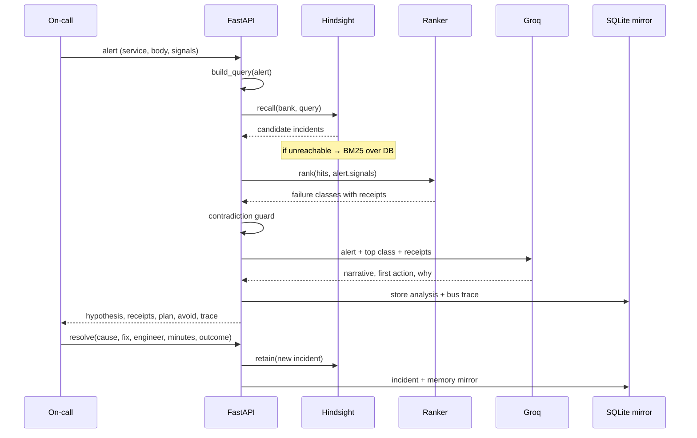

# Architecture

## The shape of the problem

An on-call engineer does not need a model that has read every runbook. They need one that has **lived through this service**. The hard part is not retrieval — it is knowing which past incident is *actually* the same, and which one merely looks the same.

Déjà Vu separates four concerns:

1. **Memory** — what happened, with provenance (`Hindsight`, bank `dejavu-oncall`).
2. **Matching** — is this the same failure, or a look-alike? (signal fingerprint + text + outcome)
3. **Judgement** — what to do, what to avoid, what to rule out (contradiction guard, plan, receipts).
4. **Learning** — did the answer hold, and is the system measurably better? (retain loop, replay).

## Data flow



## Storage

Two stores, on purpose.

| Store | Role | Why |
|---|---|---|
| **Hindsight** | Semantic memory: recall by meaning, with metadata and tags | The product requirement: memory that persists and improves |
| **SQLite** | Operational record: incidents, memories, alerts, analyses, bus | Auditability, the replay, and a demo that survives a dead server |

The SQLite mirror is not a cache in front of Hindsight — it is the source of truth for the replay and the fallback index. Every retained memory is written to both.

### Tables

```
incidents(id, ts, service, title, severity, symptom, signals, root_cause,
          cause_class, fix, fix_minutes, outcome, engineer, tags,
          discriminator, postmortem)

memories(id, incident_id, bank, text, service, root_cause, cause_class, fix,
         outcome, fix_minutes, engineer, created_at, last_confirmed,
         success_count, fail_count, stale, source)

alerts(id, ts, service, title, severity, body, signals, status,
       matched_incident, resolved_by)

analyses(id, alert_id, mode, top_incident, correct, latency_ms, payload, created_at)

bus(id, ts, op, bank, query, n_results, latency_ms, backend, detail)
```

`cause_class` is the learning unit; `root_cause` is what the UI shows. `discriminator` is the one fact that separates an incident from its look-alike.

## Matching

### 1. Recall

The alert becomes a query: service + title + body + `key=value` signals.

- **Hindsight path** — `recall(bank_id, query, max_tokens=6000, budget="mid")`. Results are mapped back to incident IDs, hydrated from SQLite.
- **Fallback path** — BM25 over the SQLite mirror, then the same hydration.

### 2. Signal similarity

For each signal present in both the alert and a memory:

```
weight  w(k)  = 2.0 for discriminating signals (cert_age_days, dns_ttl_s,
                clock_skew_s, pool_size), 1.0–1.6 for the rest,
                0.8 for generic saturation signals (p99_ms, db_cpu_pct)

numeric:  closeness = 1 - |a-b| / max(|a|,|b|, 1e-9)
string:   closeness = 1 if equal else 0

signal_similarity = Σ w·closeness / Σ w
coverage          = Σ w(shared) / Σ w(alert)
```

### 3. Text similarity

IDF coverage, not raw BM25:

```
text = Σ_{t ∈ query} idf(t) · f(t)/(f(t)+1.2)  /  Σ idf(t)
```

The retrieval document is deliberately **what the failure looked like**, not how it was fixed: service, root cause, title, symptom, tags, signal names. Fix prose and engineer names are excluded so they cannot pollute recall.

### 4. Grouping and scoring

Hits are grouped by `cause_class`. For each class:

```
similarity = 0.50·signal_similarity + 0.45·text + 0.05·coverage

score = 0.82·similarity
      + 0.10·min(1, support/3)
      + 0.08·success_rate
      + 0.02·exp(-age_days/120)

if any hit is stale: score -= 0.06
```

Confidence shown to the user:

```
confidence = clamp(0.42, 0.97,
                   0.50 + 0.42·similarity + 0.08·success_rate)
if stale: confidence -= 0.05
```

Confidence is deliberately capped: a memory system should never claim certainty from precedent alone.

## Contradiction guard

If the runner-up class has a different root cause and is within `0.18` similarity of the winner, the answer carries a guard:

- the look-alike incident ID and its similarity
- **why it is not this one** — the incident's `discriminator`
- the different fix it required

This is the failure mode of every naive RAG incident bot: two incidents that read identically but are not the same. Naming the look-alike and the signal that separates it is what makes the answer safe to act on.

## Closed loop

```
resolve(alert, cause, fix, engineer, minutes, outcome)
  → write incident + postmortem
  → memory.retain(...)  (Hindsight + SQLite mirror)
  → alert marked resolved
```

The next alert with the same fingerprint recalls the incident that was just created, so the demo's second act is genuinely learned, not pre-baked.

## Measured replay

`agent.replay()` walks incidents oldest → newest:

1. Build a window of memories whose `created_at` is **before** the incident's timestamp.
2. Skip until the service has at least 3 memories (a fair test of memory, not of luck).
3. Run the same recall → rank pipeline used live.
4. Grade the top-1 class and whether the class is in the top 3.

No LLM, no future memories. The result (33% → 83%, top-1 50%, top-3 64%) is the learning curve shown on the Learning screen.

## Failure and honesty

Every layer can fail, and each failure is visible:

| Failure | Behaviour |
|---|---|
| Hindsight unreachable | BM25 fallback; header badge turns amber `BM25 FALLBACK` |
| Hindsight recall error mid-request | Same fallback, bus line records the error |
| Groq missing / rate-limited / slow | Deterministic template narrative; trace shows `template fallback` |
| No memories above threshold | Generic playbook, explicitly labelled "not grounded" |

The trace strip under every answer lists each stage and its latency, so the system never hides which path served it.

## HTTP surface

| Method | Path | Purpose |
|---|---|---|
| `GET` | `/api/overview` | counts, services, memory stats, backend |
| `GET` | `/api/health` | memory backend + Groq availability |
| `GET` | `/api/alerts` · `POST /api/alerts` | queue / fire an alert |
| `GET` | `/api/alerts/{id}` | one alert |
| `POST` | `/api/analyze` | `{alert_id, mode: on|off}` |
| `POST` | `/api/resolve` | resolve → retain |
| `GET` | `/api/learning` | replay |
| `GET` | `/api/memory?q=` | search memories |
| `GET` | `/api/incidents` | corpus |
| `GET` | `/api/bus` | memory operations |
| `POST` | `/api/reset` | clear alerts/analyses (optionally reseed) |

## Performance

| Step | Typical |
|---|---|
| Recall (Hindsight, local) | 5–15 ms |
| Recall (BM25 fallback) | 2–8 ms |
| Ranking (34 memories) | < 2 ms |
| Groq narrative | 0.8–3 s, optional |
| Full analysis, no LLM | < 25 ms |
